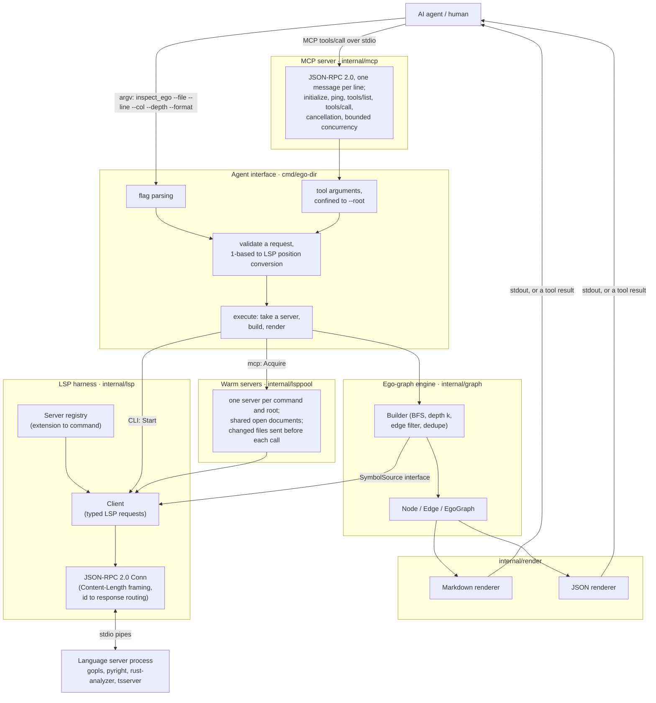
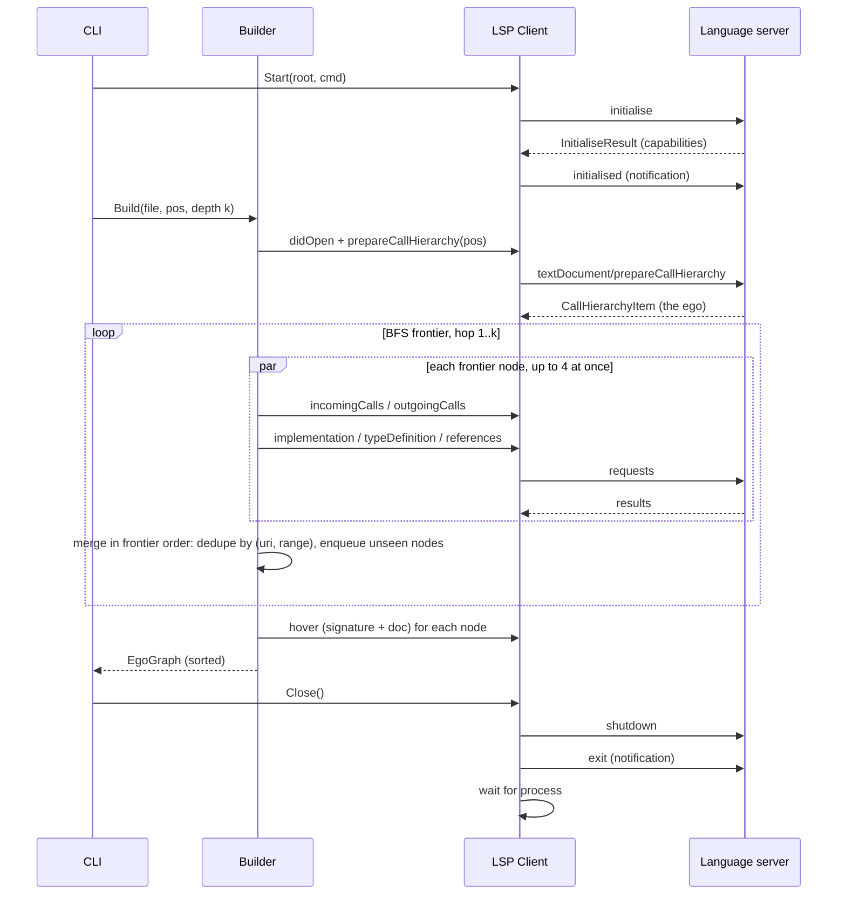

# Architecture

## Layers



The builder depends only on a narrow `SymbolSource` interface, not on the concrete LSP
client. That lets the graph logic be unit-tested against an in-memory fake graph, and lets
the LSP client be tested against an in-process fake server.

`internal/graph`, `internal/lsp` and `internal/render` know nothing about any one
programming language. What differs between languages lives in `internal/lspsource`, behind
the `Language` interface, chosen by file extension:

| Part           | Question it answers                                              | Generic                       | Go                                              |
|----------------|------------------------------------------------------------------|-------------------------------|-------------------------------------------------|
| `Naming`       | Short and qualified name of an outline entry; the type that owns a member declared outside it | names as given; members nested in the outline | `(T).M` is `M`, qualified `T.M`, owned by `T` |
| `Declarations` | Where a declaration really starts                                | as the server says            | widened over the `type` keyword                 |
| `HoverReader`  | Signature and doc from hover Markdown                            | first code block, then prose  | also drops gopls layout comments, method sets, links and package facts |
| `Modules`      | The module a file belongs to, its files and header, what it imports | none                       | the package in the file's directory (`go/parser`, `go.mod`) |

A language is a struct composed of one implementation of each part, so a new language
reuses the generic parts that fit (an object-oriented language nests members in the
outline, as the generic `Naming` expects) and supplies only what differs.

## MCP server

`ego-dir mcp` serves the position commands as tools. `internal/mcp` speaks the protocol and
knows nothing about the tools: it is given a fixed list of tools, each a name, a description,
a JSON Schema and a handler. `cmd/ego-dir` supplies the tools. A tool call's arguments become
the same `request` that flags become, and go through the same `validate` and `execute` as
the CLI, so a tool's text is byte for byte what the CLI prints.

- **Framing.** JSON-RPC 2.0, one JSON object per line on stdin and stdout. Blank lines are
  skipped. Batches (JSON arrays) are refused with `InvalidRequest`. Nothing else is written
  to stdout; diagnostics go to stderr.
- **Two eras.** The server speaks both. The era belongs to each request, not to the
  connection:
  - A **modern** request (`2026-07-28`, `mcp.ModernVersions`) names its protocol version in
    `_meta` (`io.modelcontextprotocol/protocolVersion`, with
    `io.modelcontextprotocol/clientCapabilities`) and needs no handshake. `server/discover`
    lists the supported versions and capabilities. An unknown version gets
    `UnsupportedProtocolVersion` (`-32022`) listing the supported ones; a missing field gets
    `InvalidParams`. Results carry `resultType: "complete"` and the server's name and version
    in `_meta`; `tools/list` and `server/discover` also carry `ttlMs` and `cacheScope:
    "public"`. There is no `ping`.
  - A **legacy** request (`2025-11-25`, `2025-06-18`, `2024-11-05`, `mcp.LegacyVersions`)
    has no version in `_meta` and follows `initialize`, which echoes the client's
    `protocolVersion` if it is a legacy one and otherwise answers with the latest. Legacy
    results keep their old shape. `2025-03-26` is left out: it requires servers to accept
    batches.
  - A client that speaks both probes with `server/discover`. A modern request gets a
    discovery result; a probe without `_meta` gets an error, and the client falls back to
    `initialize`.
- **Capabilities.** `{"tools": {}}`; the tool list never changes, so there is no
  `listChanged` and no `subscriptions/listen`.
- **Errors.** A JSON-RPC error is only for a protocol fault: unparseable JSON (`ParseError`),
  an unknown method (`MethodNotFound`), an unknown tool or missing name (`InvalidParams`).
  Anything that goes wrong inside a tool, including bad arguments, is a result with
  `isError: true` and the message as text, which the model can read and act on.
- **Configuration is fixed.** `--root`, `--server`, `--timeout` and `--idle` are read once. Tool
  arguments are decoded strictly, so an argument the schema does not list (such as `root`)
  is an error rather than ignored.
- **Confinement.** Every tool call sets `confine` on its request: `validate` refuses a file
  whose path, compared by name and again with symbolic links followed, is outside the root.
  The CLI does not set it.
- **Concurrency.** Each `tools/call` runs in its own goroutine, so pings and cancellations
  are read while it runs. At most `MaxConcurrent` (default 4) run at once; the rest wait for
  a slot. Calls only read, and the warm server they share answers concurrent requests (the
  client routes responses by id), so running them side by side is safe, and serialising them
  would make one slow call hold up every other.
- **Cancellation.** `notifications/cancelled` cancels the call's context. Its requests still
  waiting on the language server are cancelled with `$/cancelRequest`; the server itself keeps
  running for other calls. A cancelled call gets no reply. A call waiting for a slot gives up
  too. When stdin closes, every running call is cancelled, the server waits for them, shuts
  the warm language servers down (`shutdown`, then `exit`) and exits with `0`.

### Warm language servers

`execute` takes its language server from a provider. The CLI's starts one and stops it when
the command ends. `ego-dir mcp`'s is a pool (`internal/lsppool`) that keeps servers running
between calls, so only the first call pays for the server loading the workspace; with
`--idle 0` it uses the CLI's instead. The protocol layer does not know either way.

- **One server per command and root**, started by the first call that needs one. In MCP mode
  the root is fixed, so in practice that is one per language. Calls that arrive while it
  starts wait for the same start.
- **Lifetime.** A server is started with a context the pool owns, bounded by `--timeout`,
  not the call's. A call that gives up while its server starts leaves the start running, and
  the server is kept for the next call. Only the pool stops a server.
- **Idle shutdown.** A server unused for `--idle` (default `10m`) is shut down. At most four
  run at once; the least recently used idle one makes way for a new one, and when all four
  are busy a call for a fifth waits.
- **Failure.** A server that stops by itself is dropped, and the end of its stderr is written
  to ego-dir's stderr. The call that met it gets an `isError` result carrying that stderr;
  the next call starts a new server (once: if that start fails, the call fails).

A warm server must never answer from files as they were. Each call gets a fresh
`lspsource.Source`, so its file and outline caches last one call, and the server is kept
current two ways:

- **Open documents** are shared between calls and counted. The first call to open a document
  sends `didOpen`; a call that opens it with different text (the file was saved since) sends
  `didChange` with the whole text and the next version; the last call to finish with it sends
  `didClose`, which hands the file back to the server's view of the disk. A call sees every
  edit saved before it started; an edit saved while it runs may reach it partway through.
- **Files that are not open.** A server may not notice a file changing on disk, so the pool
  tells it (`TestGoplsEditWithoutNotification` records whether gopls would have noticed by
  itself). Before each call, the pool scans
  the root (skipping hidden directories and `node_modules`), comparing each file's size and
  modification time with the last scan. A file modified within two seconds of a scan is also
  hashed, and compared by content next time: a filesystem keeps times only so finely, so a
  same-size edit soon after a scan could otherwise go unseen. The changes go to the server as
  `workspace/didChangeWatchedFiles` before the call's first request. A changed file that
  another call holds open is also sent as `didChange`, because a server answers from an open
  document's text rather than the disk. The client declares
  dynamic registration of that notification (in the pool only; the CLI's capabilities are
  unchanged) and records the server's `client/registerCapability`. The server is restarted
  instead when it has not registered, when `go.mod`, `go.sum` or `go.work` changed, or when
  more than 500 files changed at once. A restart waits for calls still using the old server.

```mermaid
sequenceDiagram
    participant A as Agent (MCP client)
    participant M as internal/mcp
    participant T as Tool handler (cmd/ego-dir)
    participant P as Pool (internal/lsppool)
    participant S as Language server

    alt modern (2026-07-28)
        A->>M: server/discover {_meta: protocolVersion, clientCapabilities}
        M-->>A: {supportedVersions, capabilities: {tools}, ttlMs, cacheScope}
    else legacy (2025-11-25 and earlier)
        A->>M: initialize {protocolVersion}
        M-->>A: {protocolVersion, capabilities: {tools}, serverInfo}
        A->>M: notifications/initialized
    end
    A->>M: tools/list
    M-->>A: inspect_ego, resolve_definition, find_references
    A->>M: tools/call inspect_ego {file, line, col, depth}
    M->>M: wait for a free slot
    M->>T: handler(ctx, arguments)
    T->>T: decode strictly, validate (confined to --root)
    T->>P: Acquire(server, root)
    alt first call
        P->>P: scan the root
        P->>S: start, initialise (the pool's context)
        S->>P: client/registerCapability (watched files)
    else warm
        P->>P: scan the root for changes
        P->>S: workspace/didChangeWatchedFiles (or restart)
    end
    P-->>T: session
    T->>S: didOpen or didChange, then build the ego-graph
    S-->>T: answers
    T->>P: Release: didClose documents no other call holds
    T-->>M: rendered Markdown or JSON
    M-->>A: {content: [{type: text, text}], isError: false}
    opt the agent cancels
        A->>M: notifications/cancelled {requestId}
        M->>T: cancel ctx
        T->>S: $/cancelRequest for its requests
        Note over M,A: no reply for the cancelled call; the server keeps running
    end
    opt no call for --idle
        P->>S: shutdown, exit
    end
    A--xM: stdin closes
    M->>T: cancel running calls, wait
    T->>P: Close
    P->>S: shutdown, exit
    M-->>A: exit 0
```

## Request flow for `inspect_ego`

The handshake is sent as `initialise` / `initialised` first. If the server answers that with
an error (gopls, pyright, rust-analyzer and others do), the client repeats it as
`initialize` / `initialized`. Any other kind of
failure (the server exits or the stream breaks) is reported without a retry.



## Data structures

```go
type NodeID string // "<uri>#L<startLine>:<startChar>", or "module:<path>" for a module

type Range struct{ StartLine, StartCol, EndLine, EndCol int } // 1-based for output

type Node struct {
    ID        NodeID
    Name      string     // e.g. "Builder.Build"
    Qualified string     // e.g. "graph.Builder.Build"
    Kind      SymbolKind // module, function, method, struct, interface, field, ...
    URI       string     // a module's directory, or "" outside the workspace
    Range     Range      // full declaration range; zero for a module
    Selection Range      // identifier range; zero for a module
    Signature string
    Doc       string
    Body      string     // only filled for the ego, unless --body=all
    Hop       int        // 0 = ego
}

type EdgeKind string // calls | implements | instantiates | imports | contains | references

type Edge struct {
    From, To NodeID
    Kind     EdgeKind
    Weight   int // number of call sites / references collapsed into this edge
}

type EgoGraph struct {
    Ego   NodeID
    Depth int
    Nodes []Node // sorted by (Hop, URI, Range)
    Edges []Edge // sorted by (From, To, Kind)
}
```

## Edge derivation

| Edge kind      | Direction   | LSP source                                                       | Notes                                   |
|----------------|-------------|------------------------------------------------------------------|-----------------------------------------|
| `calls`        | caller to callee | `textDocument/prepareCallHierarchy`, then `callHierarchy/incomingCalls` and `callHierarchy/outgoingCalls` | Weight = number of `fromRanges`. |
| `implements`   | concrete to interface | `textDocument/implementation` on the type or method | Orientation from the outline: an interface, or a method inside one, is the target. |
| `instantiates` | user to type | `textDocument/typeDefinition` on the symbol's name (e.g. a constructor's result type) | Best-effort; depends on server support. |
| `references`   | referrer to symbol | `textDocument/references` (excluding the declaration), grouped by enclosing symbol | Fallback when call hierarchy is unsupported. |
| `imports`      | module to module | Read by the `Language` from the module's files (Go: the import declarations, with `go/parser`) | Weight = number of files that import it. Only outgoing: who imports a module is not derived. |
| `contains`     | parent to member | `textDocument/documentSymbol` (the outline), plus the `Language`'s owner of members declared outside their type | A module contains its top-level symbols; a type its fields and methods (Go methods are matched by receiver). |

A **module** is the unit code imports: a Go package, a Python module, a Rust crate. A module
node has no position. Its id is `module:<path>`, where the path is what importers write, for
example `module:example.com/sample/report` or `module:fmt`. A module in the workspace keeps
its directory as its URI, and its signature and doc come from hover on its name in its first
file (`package report`). Any other module (the standard library, the module cache) is known
by its path alone: no URI, no hover, no members, no imports. The ego is a module when the
position is on its name in a file's module declaration. Only `contains` and `imports` leave
a module, and no request about a module is sent to the server except that hover. `find_references`
on a module is a runtime error (exit code 2): references to modules are not derived.

`textDocument/definition` resolves the ego when the cursor is on a use site rather than on
the declaration. `textDocument/documentSymbol` supplies names, kinds and full ranges for
symbols that are not callable (types, interfaces), the enclosing symbol of a reference, and
whether a method belongs to an interface (needed to orient `implements` edges).
Node kinds, ranges and qualified names come from the outline, not from call hierarchy
items (gopls gives every item kind `function` and only the name as its range). A type's
range is widened to take in the `type` keyword, which gopls leaves out.
A request the server does not support counts as "no edges", not as an error.

Neighbours declared outside `--root` (the standard library, the module cache) are dropped,
along with their edges. For example, gopls answers `typeDefinition` on a function with its
result type, which for `float64` or `error` is in `$GOROOT`. Those paths depend on the
machine, and the files are not part of the workspace. The ego itself can still be outside
the root.

`textDocument/hover` supplies the signature (its first code block) and the doc (the prose
after it). gopls decorations are removed: memory-layout comments (`// size=…, class=…,
offset=…`), horizontal rules, the method-set code block and the pkg.go.dev link.

## Traversal rules

- **Directions do not mix.** Upstream is a BFS over incoming edges, downstream a BFS over
  outgoing edges. `--direction both` is the union of the two. Siblings (other callees of a
  caller) and co-callers are therefore not alters.
- **`implements` is followed both ways** in both searches, so the concrete implementation of
  a called interface method is downstream, and callers of an interface method are upstream
  of its implementations. The edge itself keeps its concrete-to-interface orientation.
- A node's hop is its shortest distance from the ego. Nodes at hop `k` are not expanded.
- Each node is expanded at most once per direction (language-server calls are expensive).
- A hop asks for its frontier's neighbours concurrently, at most four at once
  (`graph.DefaultParallel`), and merges the answers in frontier order once they are all in,
  so the graph is the same as when they are asked one at a time. The first failure cancels the
  requests still running and is the error returned. The CLI and MCP both do this.
- An edge seen from both of its ends is stored once. Its weight is the larger of the two
  reported weights, not their sum.
- Default edge kinds are `calls,implements,instantiates,imports`. `references` is opt-in,
  because with call hierarchy available it duplicates `calls`. `contains` is opt-in, because
  it lists a whole module or type.
- `contains` follows the search direction like any other kind: upstream is the parent, then
  its parent; downstream is the members. Siblings are not alters.

## Positions

- CLI input: 1-based line, 1-based column counted in characters (runes).
- LSP wire: 0-based line, 0-based column in **UTF-16 code units**.
- Conversion reads the line from disk and maps rune offset to UTF-16 offset, so multibyte
  characters and astral-plane characters (surrogate pairs) are handled. This is covered by unit tests.

## Determinism rules

1. Nodes are de-duplicated by `(URI, Selection range)`, modules by their path.
2. Nodes are sorted by `(Hop, URI, StartLine, StartCol, ID)`. Edges are sorted by `(From, To, Kind)`.
3. Paths are rendered relative to `--root` using `/` separators.
4. No timestamps, durations or absolute paths appear in output.
5. Renderers are covered by golden-file tests (`testdata/*.golden`).

## Output schemas

The reference outputs are
[`internal/render/testdata/total_area.golden.md`](../internal/render/testdata/total_area.golden.md)
and [`total_area.golden.json`](../internal/render/testdata/total_area.golden.json): the ego-graph
of `TotalArea` in `testdata/sample`, at depth 2. In outline:

```markdown
# Ego: `graph.Builder.Build`
- kind: method
- location: internal/graph/builder.go:42-88
- depth: 2

## Signature
## Doc
## Body
## Upstream (callers)        <- incoming edges, grouped by hop
## Downstream (callees)      <- outgoing edges, grouped by hop
## Implementations
## Members                   <- contains edges touching the ego, parent first
## Type dependencies
## Edges                     <- table: from | kind | to | weight
```

Empty sections are rendered as `_none_` and never omitted, so the layout stays fixed.
Upstream and downstream alters are listed per hop with signature and doc. Their bodies
appear only with `--body all`. *Implementations* lists `implements` edges touching the ego,
*Members* its `contains` edges (its parent marked `parent:`, then its members), and *Type
dependencies* its `instantiates`/`imports` edges. A module is shown by its path where a symbol
shows `file:line`. In JSON, every node has a
`role` (`ego`, `upstream`, `downstream`, `both`, or `related` for a node joined to the graph on neither side of the ego), and ids are `file:line:col` relative to
`--root`. A module's id is `module:<path>`; it has no `range`, and a `file` (its directory,
`.` for the root) only when it is in the workspace.

## Exit codes

| Code | When                                                                                |
|------|-------------------------------------------------------------------------------------|
| 0    | Success. Results on stdout; stderr is empty.                                        |
| 1    | Usage error, detected before a server starts: flags, missing file, unknown extension, position outside the file. |
| 2    | Runtime error: the server cannot start, a request fails, or no symbol is at the position. |

`ego-dir mcp` exits with `1` for bad flags, `0` when stdin closes and `2` if stdin or stdout
fails. Errors in tool calls never end it.

## Test strategy

| Layer        | Technique                                                                            |
|--------------|--------------------------------------------------------------------------------------|
| JSON-RPC     | Framing round-trips, malformed headers, concurrent ids, server-initiated requests     |
| LSP client   | In-process fake server over `net.Pipe` with canned responses; lifecycle ordering      |
| Graph        | Fake `SymbolSource` graph: depth limits, cycles, filters, dedupe, ordering            |
| Render       | Golden files, plus "render twice and compare bytes"                                    |
| CLI          | `run(args, stdout, stderr) int` tested in-process: flags, validation, exit codes      |
| MCP protocol | Scripted client over `io.Pipe`: both eras (discover, `_meta` versions, handshake), framing, errors, notifications, cancellation, the concurrency bound, EOF |
| MCP tools    | `ego-dir mcp` in-process against the fake server: tool text equals the CLI's output and the golden file; confinement; errors as `isError` |
| Graph, parallel | The parallel result equals the serial one across depths, directions and edge kinds; the bound holds; the first error cancels the rest |
| Pool         | In-process fake servers over pipes, and the fake as a process: lazy start, reuse, idle shutdown, the cap, cancellation that keeps the server, shared and counted documents, changed files sent or a restart, crashes, shutdown on close |
| Integration  | `//go:build integration`, real `gopls` on `testdata/sample`, skipped when gopls is missing. Includes what a warm gopls needs to see an edit to a file that is not open, and an edit between two MCP calls |

### Pending acceptance tests

Acceptance tests are written before the code they test, behind the `pending` build tag, so
`make test` stays green. Once the code exists, delete the `//go:build pending` line from the
files it makes pass, and `make test` (and CI) runs them from then on. `make pending` runs the
tests still waiting for their code; none are pending at the moment.

Shared fixtures, which run today:

- `testdata/sample`: a tiny Go module with a known call graph (an interface, an
  implementation, a constructor and two callers) in `shapes.go`, and a second package,
  `report/report.go`, that imports it and two standard-library packages.
- `internal/lsp/lspfake`: a scripted LSP server with its own framing code, independent of
  the client. Its `Sample` scenario answers like gopls v0.23 for `testdata/sample`, computing
  every position from the files themselves. Like gopls, it reads the files once and then
  learns of edits only from `didOpen`, `didChange`, `didClose` and
  `workspace/didChangeWatchedFiles`, and registers for the last when the client allows it.
  Test binaries re-run themselves as this server (via `EGO_DIR_LSPFAKE=sample`), which tests
  process spawning and the CLI end to end without gopls. More variables script it further:
  per-request latency, an initialise delay, a crash on demand and a log of its starts and
  clean exits.
