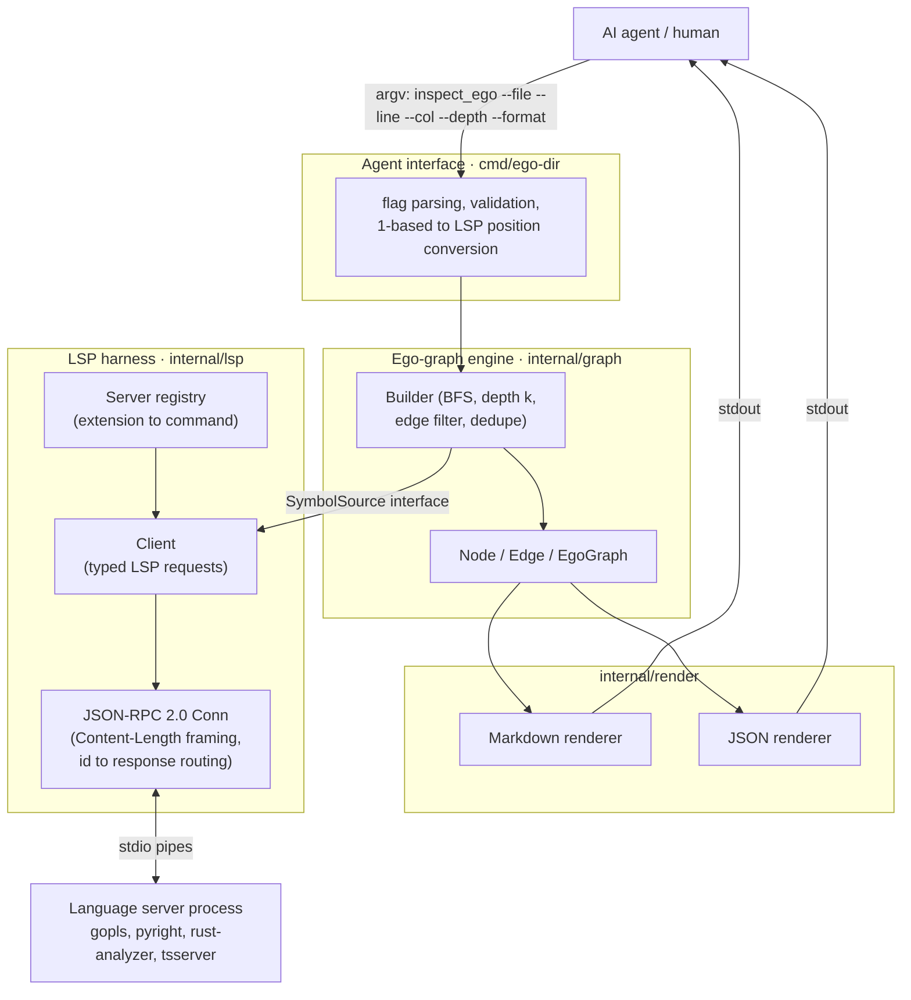
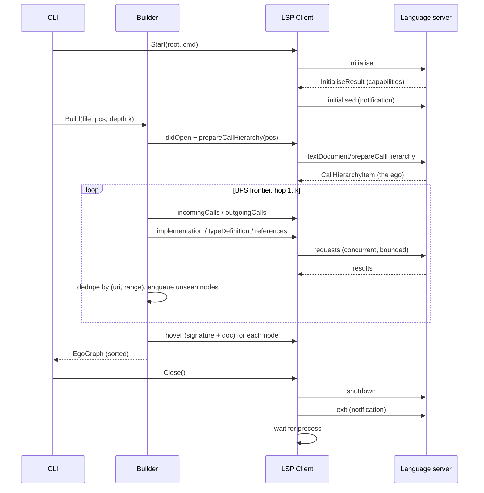

# Architecture

## Layers



The builder depends only on a narrow `SymbolSource` interface, not on the concrete LSP
client. That lets the graph logic be unit-tested against an in-memory fake graph, and lets
the LSP client be tested against an in-process fake server.

## Request flow for `inspect_ego`



## Data structures

```go
type NodeID string // "<uri>#L<startLine>:<startChar>", stable and unique

type Range struct{ StartLine, StartCol, EndLine, EndCol int } // 1-based for output

type Node struct {
    ID        NodeID
    Name      string     // e.g. "Builder.Build"
    Qualified string     // e.g. "graph.Builder.Build"
    Kind      SymbolKind // function, method, struct, interface, ...
    URI       string
    Range     Range      // full declaration range
    Selection Range      // identifier range
    Signature string
    Doc       string
    Body      string     // only filled for the ego, unless --body=all
    Hop       int        // 0 = ego
}

type EdgeKind string // calls | implements | instantiates | imports | references

type Edge struct {
    From, To NodeID
    Kind     EdgeKind
    Weight   int // number of call sites / references collapsed into this edge
}

type EgoGraph struct {
    Ego   NodeID
    Depth int
    Nodes []Node // sorted by (Hop, URI, Range)
    Edges []Edge // sorted by (From, To, Kind)
}
```

## Edge derivation

| Edge kind      | Direction   | LSP source                                                       | Notes                                   |
|----------------|-------------|------------------------------------------------------------------|-----------------------------------------|
| `calls`        | caller to callee | `textDocument/prepareCallHierarchy`, then `callHierarchy/incomingCalls` and `callHierarchy/outgoingCalls` | Weight = number of `fromRanges`. |
| `implements`   | concrete to interface | `textDocument/implementation` on the interface or method   | |
| `instantiates` | user to type | `textDocument/typeDefinition` on composite literals or constructors found within the ego's range | Best-effort; depends on server support. |
| `references`   | referrer to symbol | `textDocument/references` (excluding the declaration), grouped by enclosing symbol | Fallback when call hierarchy is unsupported. |
| `imports`      | file to package | `textDocument/documentLink` / `textDocument/definition` on import specs  |

`textDocument/definition` resolves the ego when the cursor is on a use site rather than on
the declaration.

## Positions

- CLI input: 1-based line, 1-based column counted in characters (runes).
- LSP wire: 0-based line, 0-based column in **UTF-16 code units**.
- Conversion reads the line from disk and maps rune offset to UTF-16 offset, so multibyte
  characters and astral-plane characters (surrogate pairs) are handled. This is covered by unit tests.

## Determinism rules

1. Nodes are de-duplicated by `(URI, Selection range)`.
2. Nodes are sorted by `(Hop, URI, StartLine, StartCol)`. Edges are sorted by `(From, To, Kind)`.
3. Paths are rendered relative to `--root` using `/` separators.
4. No timestamps, durations or absolute paths appear in output.
5. Renderers are covered by golden-file tests (`testdata/*.golden`).

## Markdown output schema

```markdown
# Ego: `graph.Builder.Build`
- kind: method
- location: internal/graph/builder.go:42-88
- depth: 2

## Signature
## Doc
## Body
## Upstream (callers)        <- incoming edges, grouped by hop
## Downstream (callees)      <- outgoing edges, grouped by hop
## Implementations
## Type dependencies
## Edges                     <- table: from | kind | to | weight
```

Empty sections are rendered as `_none_` and never omitted, so the layout stays fixed.

## Test strategy

| Layer        | Technique                                                                            |
|--------------|--------------------------------------------------------------------------------------|
| JSON-RPC     | Framing round-trips, malformed headers, concurrent ids, server-initiated requests     |
| LSP client   | In-process fake server over `net.Pipe` with canned responses; lifecycle ordering      |
| Graph        | Fake `SymbolSource` graph: depth limits, cycles, filters, dedupe, ordering            |
| Render       | Golden files, plus "render twice and compare bytes"                                    |
| CLI          | `run(args, stdout, stderr) int` tested in-process: flags, validation, exit codes      |
| Integration  | `//go:build integration`, real `gopls` on `testdata/`, skipped when gopls is missing  |
